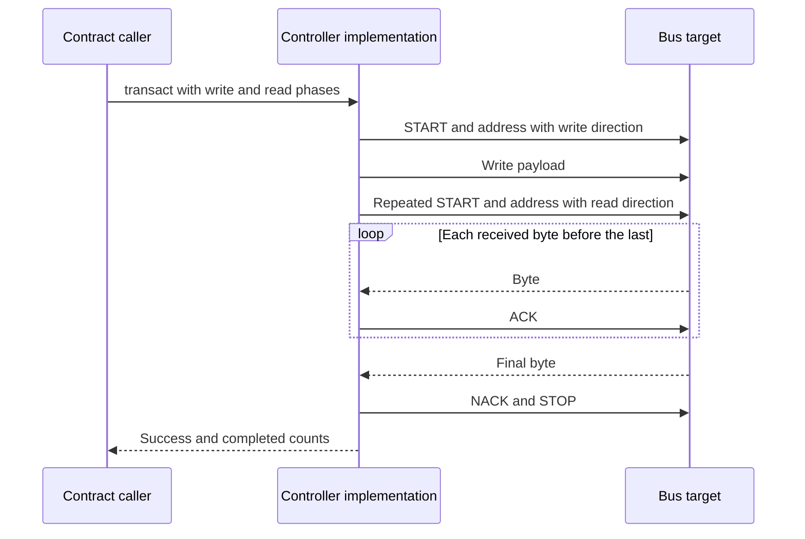

# Combined transactions and partial results

Use a combined transaction when writing a command selects what a subsequent read returns and the target expects bus ownership to be retained. It uses an initial START for write and a repeated START for read. The diagram describes a successful transfer with both phases present and at least one received byte.

## Use the result to make recovery decisions

| Result | What to inspect |
| --- | --- |
| Address NACK | The failed address phase. An earlier write phase may already have completed in a combined operation. |
| Data NACK | `written` gives the acknowledged payload prefix. Check the target protocol before retrying the entire write. |
| Timeout or bus error | Use both counts. A transaction can transfer all requested payload and still fail on closure. Consult the target's recovery procedure. |
| Arbitration lost | The implementation lost or failed to acquire control of the remaining transaction. It leaves STOP to the current owner. |

With matching transmit and receive pointers, the receive phase may overwrite information transmitted in the write phase. Keep a separate copy if the application needs the original payload after the call, including during recovery.

The caller owns buffers and retry policy. The implementation manages the bus phases and timeout. Read the [contract](contract.md) for deadlines and ownership, and the [conformance example](examples.md) for a simulated result.
